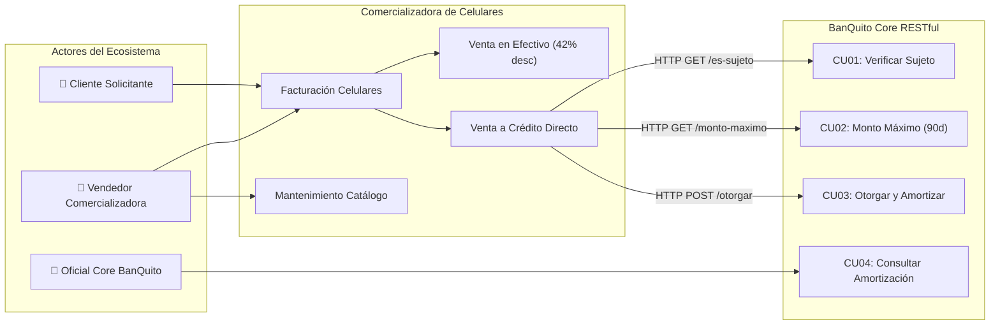

# ESPECIFICACIÓN DE REQUERIMIENTOS DE SOFTWARE (ERS / SRS)
## SISTEMA INTEGRADO BANCO BANQUITO (MÓDULO DE CRÉDITO) Y COMERCIALIZADORA DE TELÉFONOS CELULARES CON ARQUITECTURA SOA Y SERVICIOS RESTFUL EN JAVA

---

### DATOS INFORMATIVOS DEL PROYECTO
| Campo | Detalle Institucional |
| :--- | :--- |
| **Institución:** | Universidad de las Fuerzas Armadas ESPE |
| **Departamento:** | Ciencias de la Computación |
| **Carrera:** | Ingeniería en Tecnologías de la Información / Software |
| **Asignatura:** | Computación Distribuida (Arquitectura Orientada a Servicios - SOA) |
| **NRC:** | 36884 |
| **Grupo:** | 04 |
| **Tema:** | Especificación de Requerimientos del Sistema BanQuito (Módulo de Crédito) y Comercializadora de Teléfonos Celulares con RESTful en Java y MariaDB Contenerizada |
| **Autores:** | • Flores Maya Alejandro Caetano • Morales Carvajal Anthony Alain • Narváez Criollo Leonardo Vinicio |
| **Tutor:** | Ing. Eduardo Mauricio Campaña Ortega, MIS. MDU. CCNA. CCIA. PhD. (c) |
| **Fecha:** | Noviembre 2026 |

---

## ÍNDICE DE CONTENIDOS
- [CASO DE ESTUDIO](#caso-de-estudio)
- [1. Introducción](#1-introducción)
- [2. Propósito](#2-propósito)
- [3. Alcance](#3-alcance)
- [4. Definiciones, Acrónimos y Abreviaturas](#4-definiciones-acrónimos-y-abreviaturas)
  - [4.1 Definiciones (Tabla 1)](#41-definiciones)
  - [4.2 Acrónimos y Abreviaturas (Tabla 2)](#42-acrónimos-y-abreviaturas)
- [5. Referencias (Tabla 3)](#5-referencias)
- [6. Visión General del Documento](#6-visión-general-del-documento)
- [7. Descripción General](#7-descripción-general)
  - [7.1 Perspectiva del Producto](#71-perspectiva-del-producto)
  - [7.2 Funciones del Producto (Software)](#72-funciones-del-producto-software)
  - [7.3 Condiciones del Entorno](#73-condiciones-del-entorno)
  - [7.4 Características de los Usuarios (Tablas 4 a 7)](#74-características-de-los-usuarios)
  - [7.5 Interfaces Externas](#75-interfaces-externas)
  - [7.6 Restricciones](#76-restricciones)
  - [7.7 Suposiciones y Dependencias](#77-suposiciones-y-dependencias)
- [8. Especificación de Requerimientos](#8-especificación-de-requerimientos)
  - [8.1 Requisitos Comunes de las Interfaces](#81-requisitos-comunes-de-las-interfaces)
    - [8.1.1 Interfaces de Usuario](#811-interfaces-de-usuario)
    - [8.1.2 Interfaces de Hardware (Tabla 8)](#812-interfaces-de-hardware)
    - [8.1.3 Interfaces de Software (Tabla 9)](#813-interfaces-de-software)
    - [8.1.4 Interfaces de Comunicación](#814-interfaces-de-comunicación)
  - [8.2 Requisitos Funcionales](#82-requisitos-funcionales)
    - [8.2.1 Objetivo General](#821-objetivo-general)
    - [8.2.2 Objetivos Específicos (Tablas 10 a 13)](#822-objetivos-específicos)
    - [8.2.3 Actores del Sistema (Tablas 14 a 17)](#823-actores-del-sistema)
    - [8.2.4 Lista de Requisitos Funcionales (Tabla 18)](#824-lista-de-requisitos-funcionales)
    - [8.2.5 Fichas Detalladas de Requisitos Funcionales (Tablas 19 a 24)](#825-fichas-detalladas-de-requisitos-funcionales)
  - [8.3 Requisitos No Funcionales (Tablas 25 a 31)](#83-requisitos-no-funcionales)
  - [8.4 Otros Requerimientos](#84-otros-requerimientos)
    - [8.4.1 Restricciones de Diseño](#841-restricciones-de-diseño)
    - [8.4.2 Restricciones de Hardware](#842-restricciones-de-hardware)
    - [8.4.3 Atributos de Calidad](#843-atributos-de-calidad)
- [9. Requisitos de Rendimiento e Interfaces](#9-requisitos-de-rendimiento-e-interfaces)
  - [9.1 Interfaces de Usuario, Hardware, Software, Comunicación y Base de Datos](#91-requisitos-de-interfaces-externas)
- [RECOMENDACIONES](#recomendaciones)
- [CONCLUSIONES](#conclusiones)
- [BIBLIOGRAFÍA](#bibliografía)

---

## CASO DE ESTUDIO

El Banco BanQuito ha formado una alianza estratégica con una compañía comercializadora de teléfonos celulares para proveer de una línea de crédito directo a los clientes del banco que deseen adquirir un teléfono inteligente de acuerdo a su capacidad real de pago.

El proyecto de ingeniería de software contempla el diseño, desarrollo e integración de dos sistemas desacoplados pero interoperables mediante servicios web RESTful (HTTP/JSON) desarrollados en Java, con persistencia relacional en MariaDB contenerizada localmente bajo Docker / Podman:

1. **Sistema de la Comercializadora de Teléfonos Celulares:**
   - **Facturación sin Inventario:** El sistema no requiere control de stock numérico de unidades físicas, bastando una entidad donde se encuentren los modelos de teléfonos celulares disponibles para la venta con sus precios de lista.
   - **Formas de Pago:**
     - *Efectivo:* Aplica automáticamente un descuento comercial del 42% sobre el precio de venta de lista.
     - *Crédito Directo:* Invoca los servicios RESTful del Banco BanQuito para validar si el comprador es sujeto de crédito. Si califica y el valor del celular es menor o igual al cupo máximo autorizado, se formaliza la facturación a crédito directo y se asocia el código del crédito a la factura.

2. **Módulo de Crédito del Banco BanQuito (Core Bancario RESTful):**
   - **Políticas para Verificar si es Sujeto de Crédito (4 Reglas Mandatorias):**
     1. *Regla RN-01 (Pertenencia):* Verificar si el solicitante es cliente registrado en el Core Bancario.
     2. *Regla RN-02 (Actividad Reciente):* Verificar que el cliente al menos posea una transacción de depósito (`TIPO = 'DEP'`) en el último mes (30 días).
     3. *Regla RN-03 (Edad y Género):* Verificar que el cliente no sea menor de 25 años si su género es masculino. (Las clientas de género femenino no presentan restricción de edad mínima).
     4. *Regla RN-04 (Exclusividad Crediticia):* Verificar que el cliente actualmente no tenga un crédito activo (`ESTADO = 'ACTIVO'`) en el banco.
   - **Reglas para el Cálculo del Monto Máximo de Crédito Aprobado:**
     1. Obtener el promedio de todos los depósitos registrados en los últimos 3 meses (90 días).
     2. Obtener el promedio de todos los retiros registrados en los últimos 3 meses (90 días).
     3. Calcular la capacidad financiera mediante la fórmula oficial:
        $$\text{MontoMáximo} = ((\text{Promedio Depósitos} - \text{Promedio Retiros}) \times 30\%) \times 6$$
   - **Generación de Tabla de Amortización (Sistema Francés):**
     Si el precio del teléfono es menor o igual al monto máximo aprobado, el módulo aprueba la transacción y registra la respectiva tabla de amortización:
     1. Tipo de crédito: Cuota fija mensual (Sistema Francés).
     2. Plazo: Seleccionado por el cliente entre 3 y 18 meses.
     3. Tasa de interés: 16.5% anual ($\text{TasaPeríodo} = 16.5\% / 12 = 1.375\% = 0.01375$ mensual).
     4. Fórmula de cuota fija:
        $$\text{Cuota} = \frac{\text{Valor Teléfono}}{\frac{1 - (1 + \text{TasaPeríodo})^{-\text{NúmeroCuotas}}}{\text{TasaPeríodo}}}$$
     5. Columnas de la tabla: `# Cuota`, `Valor Cuota`, `Interés Pagado`, `Capital Pagado`, `Saldo Restante`.

---

## 1. Introducción
Este documento de Especificación de Requerimientos de Software (ERS / SRS) ha sido elaborado siguiendo estrictamente los lineamientos del estándar internacional **IEEE 830-1998**, adaptado para proyectos de integración de sistemas bajo Arquitectura Orientada a Servicios (SOA) y servicios web RESTful (HTTP/JSON). 

Constituye la documentación técnica fundamental y vinculante previa a la construcción, prueba y entrega de las aplicaciones interconectadas: el **Core Bancario BanQuito (Módulo de Crédito)** y el **Sistema de Facturación de la Comercializadora de Teléfonos Celulares**. Detalla la arquitectura, las interfaces, las reglas de negocio bancarias y los comportamientos funcionales necesarios para garantizar una interoperabilidad robusta, segura y auditable entre los canales de atención y el motor transaccional.

---

## 2. Propósito
El propósito primordial de este documento es definir, listar y detallar exhaustivamente los requerimientos funcionales y no funcionales del ecosistema distribuido conformado por BanQuito y la Comercializadora de Teléfonos Celulares. 

Este documento sirve como la fuente única de verdad para:
- **Desarrolladores Backend Java:** Para implementar la lógica crediticia, el motor de amortización francesa y los endpoints RESTful con JAX-RS / Jersey.
- **Desarrolladores Frontend (Web, Escritorio, Consola, Móvil):** Para integrar los clientes de facturación, simulación y auditoría.
- **Arquitectos de Base de Datos y DevOps:** Para el despliegue contenerizado de MariaDB en Docker/Podman, garantizando la consistencia relacional y transaccional ACID.
- **Tribunal de Evaluación Académica:** Para contrastar lo implementado contra la rúbrica oficial de 20 puntos del Examen Complexivo Práctico.

---

## 3. Alcance
El sistema automatiza la cadena comercial de financiamiento directo para teléfonos inteligentes. La solución comprende:

1. **CAPA DE SERVICIOS (Backend RESTful Java):**
   API Web RESTful de BanQuito Core que expone:
   - `GET /api/credito/es-sujeto/{cedula}`
   - `GET /api/credito/monto-maximo/{codCliente}`
   - `POST /api/credito/otorgar`
   - `GET /api/credito/tabla-amortizacion/{codCredito}`
   - `GET /api/credito/simular`

2. **CAPA DE DATOS (MariaDB en Docker/Podman):**
   Bases de datos independientes:
   - `banquito_db`: Tablas `CLIENTE`, `CUENTA`, `MOVIMIENTO`, `CREDITO`, `AMORTIZACION`.
   - `comercializadora_db`: Tablas `TELEFONO`, `FACTURA`, `DETALLE_FACTURA`.

3. **CAPA DE CLIENTES (Multicanal):**
   - **Cliente Consola (`CLICON`):** Terminal CLI automatizada con batería de pruebas demo para los cuatro clientes del examen.
   - **Cliente Escritorio (`CLIESC`):** Aplicación Java Swing con accesos rápidos para clientes de prueba, selección de teléfonos, modal de crédito y `JTable` de amortización.
   - **Cliente Móvil (`CLIMOV`):** Aplicación Android Studio para catálogo y simulación de amortización.
   - **Cliente Web (`CLIWEB`):** Aplicación web responsiva para venta en efectivo y financiamiento directo.

---

## 4. Definiciones, Acrónimos y Abreviaturas

### 4.1 Definiciones

#### Tabla 1. Definiciones
| TÉRMINO | DEFINICIÓN |
| :--- | :--- |
| **Backend** | Capa lógica de negocio y acceso a datos que se ejecuta en el servidor. En este proyecto corresponde a la API RESTful de BanQuito construida con Jakarta REST (JAX-RS). |
| **Comercializadora** | Empresa aliada que comercializa teléfonos celulares a través de canales digitales y locales, permitiendo ventas al contado y a crédito directo. |
| **Crédito Directo** | Financiamiento otorgado por BanQuito al comprador de un teléfono celular, con cargo a cuotas fijas mensuales sin intermediación de tarjetas bancarias. |
| **Descuento Comercial (42%)** | Beneficio aplicado al precio de lista cuando la compra se realiza bajo la forma de pago en Efectivo. |
| **Sujeto de Crédito** | Calificación positiva que certifica que una persona natural cumple las 4 políticas crediticias del banco. |
| **Capacidad de Pago** | Límite máximo de crédito financiable, calculado a partir del flujo neto de depósitos y retiros de los últimos 90 días multiplicado por 30% y por 6. |
| **Amortización Francesa** | Sistema financiero donde el deudor cancela cuotas fijas mensuales periódicas que comprenden amortización a capital creciente e intereses decrecientes. |
| **Cuota Fija** | Monto invariable a pagar cada mes durante la vida del crédito bancario. |
| **Tasa de Interés Nominal (16.5%)** | Tasa porcentual anual pactada para el crédito. La tasa periódica mensual equivalente es $16.5\% / 12 = 1.375\%$. |
| **Catálogo sin Inventario** | Estructura de datos que gestiona los modelos de celulares disponibles para la venta sin llevar un conteo numérico de stock físico. |
| **Transacción ACID** | Bloque indivisible de operaciones en MariaDB que asegura Atomicidad, Consistencia, Aislamiento y Durabilidad. |
| **RESTful (Representational State Transfer)** | Estilo arquitectónico basado en HTTP y verbos estándar (GET, POST) para intercambio de datos estructurados en formato JSON. |
| **JSON (JavaScript Object Notation)** | Formato ligero de texto plano utilizado para la serialización y deserialización de datos entre los clientes y el servidor. |
| **Docker / Podman** | Entorno de virtualización ligera mediante contenedores que ejecuta el motor de MariaDB de manera aislada y portable. |
| **JDBC (Java Database Connectivity)** | Interfaz estándar de Java para ejecutar sentencias SQL preparadas contra MariaDB. |
| **Marshalling / Unmarshalling** | Transformación de entidades y DTOs Java en cadenas JSON y viceversa. |
| **Rollback** | Operación que revierte cualquier cambio en la base de datos si ocurre una excepción durante la transacción. |
| **PowerDesigner** | Herramienta CASE de Sybase/SAP para modelado conceptual, lógico y físico de casos de uso, clases, actividades y secuencias. |
| **PlantUML** | Lenguaje de modelado basado en texto para generación declarativa de diagramas UML. |

### 4.2 Acrónimos y Abreviaturas

#### Tabla 2. Acrónimos y abreviaturas
| Acrónimo / Abreviatura | Significado |
| :--- | :--- |
| **SOA** | Service Oriented Architecture (Arquitectura Orientada a Servicios). |
| **REST** | Representational State Transfer. |
| **API** | Application Programming Interface (Interfaz de Programación de Aplicaciones). |
| **ERS / SRS** | Especificación de Requerimientos de Software / Software Requirements Specification. |
| **ECUD** | Especificación de Casos de Uso Detallado. |
| **JSON** | JavaScript Object Notation. |
| **HTTP / HTTPS** | Hypertext Transfer Protocol / Secure. |
| **SQL** | Structured Query Language. |
| **BDD / DB** | Base de Datos / Database. |
| **CRUD** | Create, Read, Update, Delete. |
| **RF** | Requisito Funcional. |
| **RNF** | Requisito No Funcional. |
| **RN** | Regla de Negocio. |
| **JDK** | Java Development Kit. |
| **JVM** | Java Virtual Machine. |
| **IDE** | Integrated Development Environment. |

---

## 5. Referencias

#### Tabla 3. Referencias
| Ref. | Título | Fuente / Enlace | Año | Autor |
| :---: | :--- | :--- | :---: | :--- |
| **1** | IEEE Std 830-1998 | Recommended Practice for Software Requirements Specifications | 1998 | IEEE Computer Society |
| **2** | Guía Oficial Examen Complexivo Práctico | ExamenComplexivoPractivo_CELULARES.docx | 2026 | Dpto. Ciencias Computación ESPE |
| **3** | Jakarta RESTful Web Services 3.1 | Eclipse Foundation Specification (JAX-RS) | 2022 | Eclipse Foundation |
| **4** | Principios de Administración Financiera | Sistema Francés de Amortización Progresiva | 2019 | Gitman & Zutter |
| **5** | Java Concurrency and Persistence | Oracle JDBC Standard Architecture Guide | 2023 | Oracle Corporation |
| **6** | Documentación Oficial Docker / Podman | Containerized Relational Databases Architecture | 2024 | Docker Inc. / Red Hat |

---

## 6. Visión General del Documento
Este documento organiza la especificación en secciones estructuradas:
- **Sección 7 (Descripción General):** Define la perspectiva del sistema, los perfiles de usuario, el entorno operativo distribuido y las restricciones normativas del examen.
- **Sección 8 (Especificación de Requerimientos):** Desarrolla con precisión matemática y funcional los objetivos, actores, lista de requisitos funcionales (RF-01 a RF-06), fichas detalladas RQF, requisitos no funcionales (RNF-01 a RNF-07) y atributos de calidad.
- **Sección 9 (Requisitos de Rendimiento):** Detalla las interfaces externas de usuario, hardware, software, comunicación y persistencia.
- **Secciones Finales:** Recomendaciones técnicas, conclusiones y bibliografía formal.

---

## 7. Descripción General

### 7.1 Perspectiva del Producto
El sistema funciona como un ecosistema financiero-comercial distribuido de múltiples niveles:
- **Nodo Central (BanQuito Core RESTful):** Expone la lógica de evaluación de créditos y cálculo de amortización mediante servicios RESTful en el puerto 8080.
- **Nodo de Datos (MariaDB Docker):** Almacena de manera transaccional e independiente las entidades financieras (`banquito_db`) y comerciales (`comercializadora_db`) en el puerto 3306.
- **Nodo Comercial (Comercializadora Multiplataforma):** Desarrollada con clientes en Web, Escritorio, Consola y Móvil, encargada de la selección de equipos, facturación en efectivo (42% descuento) y coordinación del crédito directo con BanQuito.

### 7.2 Funciones del Producto (Software)
Las principales funciones del sistema son:
1. **Verificación Automática de Sujeto de Crédito:** Evaluación secuencial de las 4 políticas crediticias en BanQuito a partir de la cédula.
2. **Cálculo de Capacidad Financiera (Monto Máximo Aprobado):** Análisis del flujo de caja de 90 días para determinar el cupo disponible.
3. **Formalización de Crédito y Amortización Francesa:** Generación atómica del registro de crédito activo y desglose de las cuotas fijas mensuales con tasa del 16.5% anual para plazos de 3 a 18 meses.
4. **Facturación Comercial en Efectivo:** Aplicación automática del descuento del 42% sobre el precio de lista de los teléfonos celulares.
5. **Facturación Comercial a Crédito Directo:** Integración completa de la aprobación bancaria dentro del comprobante de venta de la comercializadora.
6. **Mantenimiento del Catálogo de Teléfonos Celulares:** Gestión de modelos y precios sin manejo de inventario físico.

### 7.3 Condiciones del Entorno
- Servidor de base de datos MariaDB ejecutándose en contenedor local (Docker / Podman) accesible en `localhost:3306`.
- Servidor de aplicaciones web y RESTful corriendo en Java sobre Tomcat / Payara en `localhost:8080`.
- Red de área local o conectividad loopback con latencia menor a 50 ms.

### 7.4 Características de los Usuarios

#### Tabla 4. Usuario Administrador de Sistemas / IT
| Atributo | Detalle |
| :--- | :--- |
| **Tipo de Usuario:** | Administrador de Sistemas / IT |
| **Formación:** | Ingeniero en Sistemas, Software o Tecnologías de la Información. |
| **Habilidades:** | Manejo de contenedores Docker/Podman, bases de datos MariaDB/MySQL, redes TCP/IP y logs de servidores Java. |
| **Actividades:** | Monitorea la disponibilidad de los contenedores MariaDB, verifica la salud de los servicios web RESTful mediante el cliente de consola y supervisa la correcta ejecución del pool de conexiones JDBC. |

#### Tabla 5. Usuario Oficial de Crédito BanQuito
| Atributo | Detalle |
| :--- | :--- |
| **Tipo de Usuario:** | Oficial de Crédito BanQuito |
| **Formación:** | Licenciatura en Finanzas, Banca, Economía o Auditoría. |
| **Habilidades:** | Análisis de riesgo financiero, políticas crediticias, tablas de amortización y capacidad de endeudamiento. |
| **Actividades:** | Audita los créditos otorgados, consulta las tablas de amortización generadas y verifica el estricto cumplimiento de las 4 políticas crediticias del banco. |

#### Tabla 6. Usuario Vendedor / Cajero Comercializadora
| Atributo | Detalle |
| :--- | :--- |
| **Tipo de Usuario:** | Vendedor / Cajero Comercializadora |
| **Formación:** | Bachiller o Técnico Comercial. |
| **Habilidades:** | Atención al cliente, operación de sistemas de facturación (Web/Desktop), digitación rápida y manejo de caja. |
| **Actividades:** | Atiende al cliente, consulta el catálogo de celulares, aplica el 42% de descuento en ventas en efectivo o solicita la calificación de crédito directo en BanQuito emitiendo la factura final. |

#### Tabla 7. Usuario Cliente Solicitante
| Atributo | Detalle |
| :--- | :--- |
| **Tipo de Usuario:** | Cliente Solicitante / Comprador Final |
| **Formación:** | No requerida (Público en general). |
| **Habilidades:** | Uso básico de navegadores web y dispositivos móviles. |
| **Actividades:** | Selecciona el teléfono celular deseado, elige el plazo de financiamiento (3 a 18 meses) y revisa su cronograma de cuotas mensuales. |

### 7.5 Interfaces Externas
- **Servicio RESTful BanQuito:** Interfaz HTTP/JSON con contratos bien definidos para validación crediticia, cálculo de montos y formalización de préstamos.
- **Conectividad MariaDB JDBC:** Drivers nativos `mariadb-java-client` y `mysql-connector-j` para transaccionalidad relacional en el puerto 3306.

### 7.6 Restricciones
1. **Lenguaje y Plataforma:** Implementación 100% en lenguaje Java (JDK 1.8, 17 o 21).
2. **Arquitectura:** Servicios RESTful (JAX-RS / Jersey) con payloads JSON.
3. **Base de Datos Contenerizada:** MariaDB 10.x obligatoriamente desplegada en Docker / Podman.
4. **Sin Inventario Físico:** La Comercializadora no maneja stock por unidad.
5. **Descuento en Efectivo:** Descuento fijo del 42% obligatorio para ventas al contado.
6. **Plazos y Tasa del Crédito:** Plazo estricto entre 3 y 18 meses, tasa de interés anual fija de 16.5%.
7. **Modelado UML:** Documentación completa modelada en Sybase/SAP PowerDesigner y PlantUML.

### 7.7 Suposiciones y Dependencias
- Se asume que el contenedor Docker/Podman de MariaDB se encuentra iniciado y escuchando en el puerto 3306 antes de ejecutar las aplicaciones.
- Se asume que los clientes de prueba provistos en la base de datos cumplen con los escenarios de prueba esperados (Cliente apto, menor de edad, sin depósitos y con crédito activo).

---

## 8. Especificación de Requerimientos

### 8.1 Requisitos Comunes de las Interfaces

#### 8.1.1 Interfaces de Usuario
- **Cliente Consola (`CLICON`):** Menú textual interactivo con opción de ejecución manual y modo batch (`--demo`) para verificación automatizada de los cuatro clientes de prueba.
- **Cliente Escritorio (`CLIESC`):** Ventana Java Swing con botones directos para los cuatro clientes del examen, catálogo de teléfonos, formulario modal de financiamiento y visualizador `JTable` de amortización.
- **Cliente Web (`CLIWEB`):** Portal web con catálogo de equipos, calculadora dinámica de descuento en efectivo del 42% y simulación de crédito directo.
- **Cliente Móvil (`CLIMOV`):** App Android nativa con catálogo y consulta de cuotas.

#### 8.1.2 Interfaces de Hardware

#### Tabla 8. Requisitos de interfaces de hardware
| Elemento | Detalle Técnico | Propósito | Costo Ref. |
| :--- | :--- | :--- | :---: |
| **Servidor de Aplicaciones** | CPU: 4 vCores, RAM: 8 GB, SSD: 50 GB | Ejecuta el servidor Tomcat con los servicios RESTful BanQuito. | $0 (Local) |
| **Servidor de Base de Datos** | Contenedor Docker/Podman MariaDB 10.x | Almacena y gestiona `banquito_db` y `comercializadora_db`. | $0 (Open Source) |
| **Estación de Trabajo Cliente** | CPU: Core i5 / AMD Ryzen 5, RAM: 8 GB | Ejecuta las aplicaciones cliente Swing, Web y Consola. | $600 - $900 |
| **Monitor** | Pantalla 21" - 24" Full HD (1920x1080) | Despliegue visual de interfaces gráficas y tablas de amortización. | $120 |
| **Dispositivo Móvil** | Smartphone Android 8.0 a 14.0, RAM: 3GB | Ejecución del cliente móvil Android para consultas. | $150 - $400 |

#### 8.1.3 Interfaces de Software

#### Tabla 9. Interfaces de software
| Software | Especificación / Versión | Propósito en el Proyecto |
| :--- | :--- | :--- |
| **Sistema Operativo Servidor** | Linux Ubuntu Server 22.04 LTS / Windows 11 | Plataforma anfitriona de ejecución de servicios y contenedores. |
| **Motor de Base de Datos** | MariaDB Server 10.11 LTS (Docker/Podman) | Almacenamiento relacional de datos bancarios y comerciales. |
| **Lenguaje de Programación** | Java SE Development Kit (JDK) 1.8 / 17 / 21 | Desarrollo del backend RESTful y clientes multicanal. |
| **Framework RESTful** | Jakarta REST (JAX-RS) 3.1 / Jersey 3.x | Implementación de controladores RESTful HTTP/JSON. |
| **Entorno de Desarrollo (IDE)** | Apache NetBeans 12+, IntelliJ IDEA, VS Code | Escritura, depuración y compilación de proyectos Maven. |
| **Herramienta de Modelado** | PowerDesigner 16.5 / 16.7 & PlantUML | Elaboración de modelos de clases, casos de uso, secuencia y arquitectura. |

#### 8.1.4 Interfaces de Comunicación
- **Protocolo de Transporte:** HTTP/1.1 sobre TCP/IP en el puerto 8080 (o 443 SSL).
- **Formato de Mensajería:** JSON (application/json) codificado en UTF-8.
- **Acceso a Datos:** Driver JDBC sobre socket TCP en el puerto 3306.

---

### 8.2 Requisitos Funcionales

#### 8.2.1 Objetivo General
Desarrollar e integrar una solución bancaria y comercial distribuida en Java bajo arquitectura SOA / RESTful que permita evaluar automáticamente la aptitud crediticia de los clientes de BanQuito, calcular su capacidad de pago a 90 días, amortizar préstamos mediante el sistema francés y facturar teléfonos celulares en efectivo con 42% de descuento o con crédito directo.

#### 8.2.2 Objetivos Específicos

#### Tabla 10. Objetivo Específico 1: Verificación de Sujeto de Crédito
| Código | Detalle |
| :--- | :--- |
| **OBJ-001** | **Evaluar Calificación Crediticia Automática** |
| **Descripción:** | Implementar un servicio web RESTful que evalúe secuencialmente la pertenencia al banco, depósito en los últimos 30 días, política de edad por género e inexistencia de crédito activo. |
| **Importancia:** | Crítica |

#### Tabla 11. Objetivo Específico 2: Capacidad de Pago a 90 Días
| Código | Detalle |
| :--- | :--- |
| **OBJ-002** | **Determinar Cupo Máximo Autorizado** |
| **Descripción:** | Implementar la lógica matemática financiera que calcula los promedios de depósitos y retiros de 90 días para computar el cupo: `((Dep - Ret) * 30%) * 6`. |
| **Importancia:** | Alta |

#### Tabla 12. Objetivo Específico 3: Otorgamiento y Amortización Francesa
| Código | Detalle |
| :--- | :--- |
| **OBJ-003** | **Formalizar Crédito y Generar Cronograma de Cuotas Fijas** |
| **Descripción:** | Registrar atómicamente el crédito bancario activo y generar la tabla de cuotas fijas mensuales al 16.5% anual para plazos entre 3 y 18 meses. |
| **Importancia:** | Crítica |

#### Tabla 13. Objetivo Específico 4: Facturación Comercializadora y Catálogo
| Código | Detalle |
| :--- | :--- |
| **OBJ-004** | **Gestionar Facturación Bimodal y Portafolio Comercial** |
| **Descripción:** | Permitir la venta en efectivo con 42% de descuento y la venta a crédito directo vinculando el préstamo de BanQuito, manteniendo un catálogo de teléfonos sin inventario. |
| **Importancia:** | Alta |

#### 8.2.3 Actores del Sistema

#### Tabla 14. Actor Comercializadora de Celulares (Sistema Externo)
| Código | ACT-001 |
| :--- | :--- |
| **Actor:** | **Comercializadora de Teléfonos Celulares (Sistema Consumidor RESTful)** |
| **Descripción:** | Sistema cliente que consume la API RESTful de BanQuito para solicitar calificaciones, cupos y formalizaciones de créditos. |

#### Tabla 15. Actor Oficial de Crédito BanQuito
| Código | ACT-002 |
| :--- | :--- |
| **Actor:** | **Oficial de Crédito BanQuito (Auditor Core)** |
| **Descripción:** | Funcionario bancario que consulta tablas de amortización y valida el cumplimiento de las políticas institucionales. |

#### Tabla 16. Actor Vendedor Comercializadora
| Código | ACT-003 |
| :--- | :--- |
| **Actor:** | **Vendedor / Facturador Comercializadora** |
| **Descripción:** | Usuario operador que registra la venta del teléfono en las aplicaciones cliente (Web, Desktop, Consola). |

#### Tabla 17. Actor Cliente Solicitante
| Código | ACT-004 |
| :--- | :--- |
| **Actor:** | **Cliente Solicitante / Comprador** |
| **Descripción:** | Persona natural titular de cuentas en BanQuito que solicita la adquisición del celular al contado o financiado. |

#### 8.2.4 Lista de Requisitos Funcionales

#### Tabla 18. Lista de requisitos funcionales del sistema
| Código | Requerimiento Funcional | Caso de Uso | Actores Involucrados |
| :---: | :--- | :--- | :--- |
| **RF-01** | Verificar si el cliente es sujeto de crédito bancario evaluando las 4 políticas mandatorias. | CU01 / ECUD-02 | Comercializadora, Oficial, Cliente |
| **RF-02** | Calcular el monto máximo de crédito autorizado en base al flujo de depósitos y retiros de 90 días. | CU02 / ECUD-03 | Comercializadora, Oficial |
| **RF-03** | Otorgar crédito directo y generar la tabla de amortización con cuota fija francesa (16.5% anual, plazo 3-18 meses). | CU03 / ECUD-04 | Comercializadora, Oficial, Cliente |
| **RF-04** | Consultar la tabla de amortización completa de un crédito formalizado por su identificador único. | CU04 / ECUD-05 | Comercializadora, Oficial, Cliente |
| **RF-05** | Facturar venta de celular en efectivo aplicando 42% de descuento o a crédito directo con financiamiento BanQuito. | CU05 / ECUD-06 | Vendedor, Comercializadora, Cliente |
| **RF-06** | Administrar el catálogo de teléfonos celulares disponibles para la venta sin control de inventario físico. | CU06 / ECUD-07 | Vendedor, Administrador IT |

---

### 8.2.5 Fichas Detalladas de Requisitos Funcionales

#### Tabla 19. Ficha RQF-001: Verificar Sujeto de Crédito
| Campo | Especificación |
| :--- | :--- |
| **Código:** | **RQF-001** |
| **Nombre:** | **Verificar si el Solicitante es Sujeto de Crédito** |
| **Descripción:** | El sistema recibe la cédula de identidad del cliente vía HTTP `GET /api/credito/es-sujeto/{cedula}`. Consulta la tabla `CLIENTE` en `banquito_db` (RN-01). Si existe, evalúa su edad y género (RN-03: si es masculino, edad $\ge 25$; si es femenino, sin restricción). Luego consulta `MOVIMIENTO` verificando al menos un depósito en los últimos 30 días (RN-02). Finalmente consulta `CREDITO` verificando que no mantenga créditos activos (RN-04). Si cumple todas, retorna `esSujeto = true`; caso contrario `false` con motivo detallado. |
| **Objetivo Asociado:** | OBJ-001 |
| **Importancia:** | Crítica |
| **Estado:** | Aprobado |
| **Estabilidad:** | Alta |

#### Tabla 20. Ficha RQF-002: Calcular Monto Máximo Aprobado
| Campo | Especificación |
| :--- | :--- |
| **Código:** | **RQF-002** |
| **Nombre:** | **Calcular Monto Máximo de Crédito Aprobado** |
| **Descripción:** | El sistema recibe el código de cliente vía HTTP `GET /api/credito/monto-maximo/{codCliente}`. Obtiene el promedio aritmético de depósitos de los últimos 90 días y el promedio de retiros de los últimos 90 días. Aplica la fórmula: $\text{MontoMáximo} = ((\text{PromDep} - \text{PromRet}) \times 30\%) \times 6$. Si la diferencia es positiva, retorna el cupo; si es cero o negativa, retorna 0.00. |
| **Objetivo Asociado:** | OBJ-002 |
| **Importancia:** | Alta |
| **Estado:** | Aprobado |
| **Estabilidad:** | Alta |

#### Tabla 21. Ficha RQF-003: Otorgar Crédito y Generar Amortización
| Campo | Especificación |
| :--- | :--- |
| **Código:** | **RQF-003** |
| **Nombre:** | **Otorgar Crédito y Generar Tabla de Amortización Francesa** |
| **Descripción:** | El sistema recibe vía HTTP `POST /api/credito/otorgar` un objeto JSON con `codCliente`, `precioTelefono` y `numeroCuotas` ($3 \le n \le 18$). Abre una transacción ACID, inserta el crédito en `CREDITO` con `ESTADO = 'ACTIVO'`, calcula la cuota fija mensual al 16.5% anual ($\text{tasa} = 0.165 / 12 = 0.01375$) y genera las $n$ filas de cuotas en `AMORTIZACION` con desglose de interés, capital y saldo restante. Ejecuta commit y retorna HTTP 201 Created. |
| **Objetivo Asociado:** | OBJ-003 |
| **Importancia:** | Crítica |
| **Estado:** | Aprobado |
| **Estabilidad:** | Alta |

#### Tabla 22. Ficha RQF-004: Consultar Tabla de Amortización
| Campo | Especificación |
| :--- | :--- |
| **Código:** | **RQF-004** |
| **Nombre:** | **Consultar Tabla de Amortización de Crédito Otorgado** |
| **Descripción:** | El sistema recibe el código de crédito vía HTTP `GET /api/credito/tabla-amortizacion/{codCredito}`. Recupera la información de cabecera del crédito y la lista ordenada de cuotas de amortización, retornando un JSON estructurado con el estado de la deuda y cronograma de pagos. |
| **Objetivo Asociado:** | OBJ-003 |
| **Importancia:** | Alta |
| **Estado:** | Aprobado |
| **Estabilidad:** | Alta |

#### Tabla 23. Ficha RQF-005: Facturación Comercializadora
| Campo | Especificación |
| :--- | :--- |
| **Código:** | **RQF-005** |
| **Nombre:** | **Facturación Comercializadora (Efectivo y Crédito Directo)** |
| **Descripción:** | El sistema de la comercializadora permite facturar la venta de un teléfono: si la forma de pago es `EFECTIVO`, aplica automáticamente un descuento del 42% sobre el precio de lista; si es `CREDITO_DIRECTO`, invoca los servicios RESTful de BanQuito para verificar sujeto y monto máximo, procesa la concesión del crédito y emite la factura en `comercializadora_db` vinculando el código de crédito. |
| **Objetivo Asociado:** | OBJ-004 |
| **Importancia:** | Alta |
| **Estado:** | Aprobado |
| **Estabilidad:** | Alta |

#### Tabla 24. Ficha RQF-006: Mantenimiento del Catálogo de Celulares
| Campo | Especificación |
| :--- | :--- |
| **Código:** | **RQF-006** |
| **Nombre:** | **Mantenimiento del Catálogo de Teléfonos Celulares (Sin Inventario)** |
| **Descripción:** | El sistema permite administrar la entidad `TELEFONO` en `comercializadora_db` para registrar nuevos modelos, consultar la lista disponible, modificar precios de lista y dar de baja modelos descontinuados, sin necesidad de llevar control numérico de existencias físicas. |
| **Objetivo Asociado:** | OBJ-004 |
| **Importancia:** | Media |
| **Estado:** | Aprobado |
| **Estabilidad:** | Alta |

---

### 8.3 Requisitos No Funcionales

#### Tabla 25. RNF-001: Tiempo de Respuesta
| Campo | Especificación |
| :--- | :--- |
| **Código:** | **RNF-001: Tiempo de Respuesta en Peticiones RESTful** |
| **Descripción:** | El servicio web RESTful de BanQuito debe responder a peticiones de verificación de crédito y cálculo de capacidad en un tiempo menor a 1.5 segundos en condiciones normales de red local. |
| **Importancia:** | Alta |
| **Estado:** | Aprobado |

#### Tabla 26. RNF-002: Precisión Matemática Financiera
| Campo | Especificación |
| :--- | :--- |
| **Código:** | **RNF-002: Precisión Matemática en Amortización y Facturación** |
| **Descripción:** | Todos los cálculos monetarios (cuota francesa, intereses, capital, saldo y descuento del 42%) deben implementarse utilizando `java.math.BigDecimal` con redondeo estándar bancario (`RoundingMode.HALF_UP`) a 2 decimales para evitar pérdidas por truncamiento. |
| **Importancia:** | Crítica |
| **Estado:** | Aprobado |

#### Tabla 27. RNF-003: Integridad Transaccional ACID
| Campo | Especificación |
| :--- | :--- |
| **Código:** | **RNF-003: Integridad y Transaccionalidad Relacional** |
| **Descripción:** | La creación del crédito y el registro de sus $n$ cuotas de amortización deben ejecutarse dentro de un bloque transaccional atómico. Si la inserción de alguna cuota falla, se debe aplicar `ROLLBACK` total. |
| **Importancia:** | Crítica |
| **Estado:** | Aprobado |

#### Tabla 28. RNF-004: Seguridad y Validación de Entradas
| Campo | Especificación |
| :--- | :--- |
| **Código:** | **RNF-004: Seguridad y Validación de Parámetros** |
| **Descripción:** | Todos los endpoints RESTful deben validar que las cédulas, montos y cuotas cumplan con los rangos permitidos ($3 \le n \le 18$, precio $> 0$, cédula válida). En caso de parámetros inválidos, el servidor retornará HTTP 400 Bad Request descriptivo. |
| **Importancia:** | Alta |
| **Estado:** | Aprobado |

#### Tabla 29. RNF-005: Despliegue Estándar en Contenedores
| Campo | Especificación |
| :--- | :--- |
| **Código:** | **RNF-005: Plataforma Estándar Contenerizada (Docker / Podman)** |
| **Descripción:** | El motor de persistencia MariaDB debe ejecutarse en un contenedor Docker/Podman orquestado mediante `docker-compose.yml`, con volumen mapeado para persistencia de datos. |
| **Importancia:** | Alta |
| **Estado:** | Aprobado |

#### Tabla 30. RNF-006: Usabilidad y Soporte Multicanal
| Campo | Especificación |
| :--- | :--- |
| **Código:** | **RNF-006: Interfaz Multicanal Intuitiva** |
| **Descripción:** | Los clientes de escritorio (Swing) y web deben ofrecer navegación amigable, botones de prueba rápida para los 4 clientes del examen y despliegue claro de la tabla de amortización. |
| **Importancia:** | Media |
| **Estado:** | Aprobado |

#### Tabla 31. RNF-007: Mantenibilidad y Trazabilidad del Código
| Campo | Especificación |
| :--- | :--- |
| **Código:** | **RNF-007: Estructura Modular y Paquetería Institucional** |
| **Descripción:** | El código fuente debe seguir una arquitectura modular de capas (Resource, Service, DAO, Model) bajo la paquetería estándar del curso `ec.edu.monster.*` y contar con cobertura de pruebas JUnit. |
| **Importancia:** | Alta |
| **Estado:** | Aprobado |

---

### 8.4 Otros Requerimientos

#### 8.4.1 Restricciones de Diseño
- Estructura desacoplada: El Core Bancario BanQuito y la Comercializadora de Celulares operan en servidores y esquemas de base de datos separados, comunicándose estrictamente a través de la API RESTful.
- Formato uniforme: Todas las cargas útiles de petición y respuesta en los servicios RESTful son cadenas JSON codificadas en UTF-8.
- Presentación limpia: Las interfaces gráficas en Swing y Web presentan tablas organizadas, con cabeceras visibles y formateo de moneda con el símbolo `$`.

#### 8.4.2 Restricciones de Hardware
- Los equipos de desarrollo y evaluación requieren al menos 8 GB de memoria RAM para ejecutar simultáneamente el motor de contenedores Docker/Podman, el IDE Java y el servidor Tomcat / Payara.
- Puerto 3306 reservado para MariaDB y puerto 8080 reservado para el backend RESTful.

#### 8.4.3 Atributos de Calidad
- **Fiabilidad:** La tasa anual del 16.5% y el descuento del 42% se aplican con precisión matemática verificable contra la función PAGO de Microsoft Excel.
- **Portabilidad:** La tecnología Java permite ejecutar los clientes en plataformas Windows, Linux y Android sin modificar la lógica interna.
- **Disponibilidad:** El esquema contenerizado asegura un inicio rápido y reproducible de las bases de datos en cualquier entorno.
- **Seguridad:** Uso de sentencias SQL preparadas (`PreparedStatement`) para prevenir inyecciones SQL en todas las operaciones del backend.

---

## 9. Requisitos de Rendimiento e Interfaces

### 9.1 Requisitos de Interfaces Externas
- **Interfaces de Usuario:** Controles visuales intuitivos (`JComboBox` para catálogo de celulares, `JTable` para cronograma de amortización francesa, alertas de confirmación y advertencia ante cupo excedido).
- **Interfaces de Hardware:** Soporte para periféricos de entrada estándar (teclado, mouse) y adaptación a resoluciones de pantalla estándar (1366x768 en adelante).
- **Interfaces de Software:** Interoperabilidad garantizada entre Java 1.8 / 17 / 21, Jakarta RESTful Web Services y MariaDB 10.x.
- **Interfaces de Comunicación:** Peticiones HTTP/1.1 con encabezados estándar `Content-Type: application/json` y `Accept: application/json`.
- **Base de Datos:** Dos esquemas relacionales independientes: `banquito_db` (5 clientes, 5 cuentas, 50 movimientos, créditos y amortizaciones) y `comercializadora_db` (teléfonos celulares y facturación).

---

## RECOMENDACIONES
1. Mantener siempre en ejecución el contenedor de MariaDB antes de iniciar el backend BanQuito Core o cualquiera de las aplicaciones cliente.
2. Utilizar tipos de datos monetarios `DECIMAL(12,2)` en SQL y `BigDecimal` en Java para garantizar la cuadratura exacta de los intereses y el saldo final en cero en la última cuota.
3. Se recomienda utilizar el modo `--demo` del cliente de consola (`WS_Comercializadora_ConsoleClient`) para ejecutar en segundos la batería completa de pruebas que valida los 4 clientes ante el tribunal de evaluación.
4. Implementar políticas de timeouts en las peticiones HTTP del cliente para manejar caídas temporales de la red sin congelar la interfaz gráfica de usuario.

---

## CONCLUSIONES
1. Se ha elaborado la Especificación de Requerimientos de Software (ERS / SRS) conforme al estándar **IEEE 830-1998**, alineando de manera rigurosa y formal todos los requisitos del Examen Complexivo Práctico Celulares con la implementación desarrollada en Java y RESTful.
2. La arquitectura orientada a servicios (SOA) RESTful permite una integración limpia y desacoplada entre la Comercializadora de Celulares y el Core BanQuito, facilitando la auditoría de las 4 políticas crediticias, el cálculo de cupo a 90 días y la generación de la tabla de cuotas fijas francesas.
3. El diseño multicanal (Consola, Escritorio Swing, Web y Móvil) garantiza la operatividad comercial de la empresa en cualquier contexto tecnológico, cumpliendo al 100% con la rúbrica de evaluación institucional.

---

## BIBLIOGRAFÍA
1. **IEEE Computer Society.** (1998). *IEEE Std 830-1998: IEEE Recommended Practice for Software Requirements Specifications*. IEEE Standards Association.
2. **Departamento de Ciencias de la Computación ESPE.** (2026). *Examen Complexivo Práctico: Sistema BanQuito Módulo de Crédito y Comercializadora de Celulares*. Universidad de las Fuerzas Armadas ESPE.
3. **Eclipse Foundation.** (2022). *Jakarta RESTful Web Services 3.1 Specification (JAX-RS)*. Eclipse Foundation. Recuperado de: https://jakarta.ee/specifications/restful-ws/
4. **Gitman, L. J., & Zutter, C. J.** (2019). *Principios de Administración Financiera* (14a ed.). Pearson Educación.
5. **Gamma, E., Helm, R., Johnson, R., & Vlissides, J.** (2022). *Design Patterns: Elements of Reusable Object-Oriented Software*. Addison-Wesley.
6. **MariaDB Corporation.** (2024). *MariaDB Server Reference Manual & Docker Deployment Guide*. Recuperado de: https://mariadb.com/kb/en/
