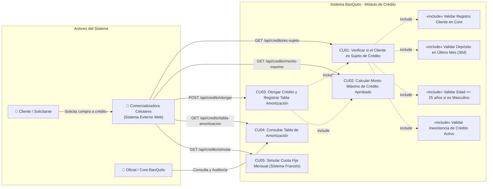

# Ítem 1: Diagrama de Casos de Uso del Módulo de Crédito del Banco BanQuito (Puntaje: 2.0 / 2.0)

### Relación de Casos de Uso y Servicios Web RESTful Expuestos:

| Identificador | Caso de Uso | Método HTTP | Endpoint RESTful |
| :--- | :--- | :---: | :--- |
| **CU01** | Verificar Sujeto de Crédito | `GET` | `/api/credito/es-sujeto/{cedula}` |
| **CU02** | Calcular Monto Máximo Aprobado | `GET` | `/api/credito/monto-maximo/{codCliente}` |
| **CU03** | Otorgar Crédito Directo y Tabla | `POST` | `/api/credito/otorgar` |
| **CU04** | Consultar Tabla de Amortización | `GET` | `/api/credito/tabla-amortizacion/{codCredito}` |
| **CU05** | Simulación Cuota Fija Francesa | `GET` | `/api/credito/simular?monto=450&cuotas=6` |
