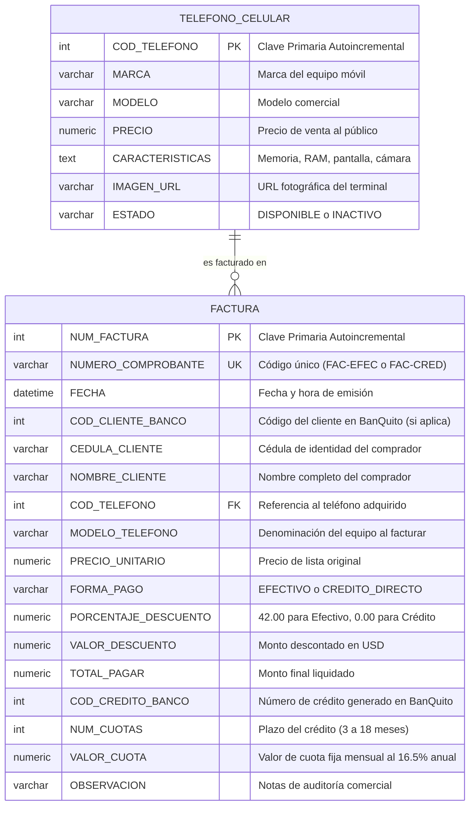
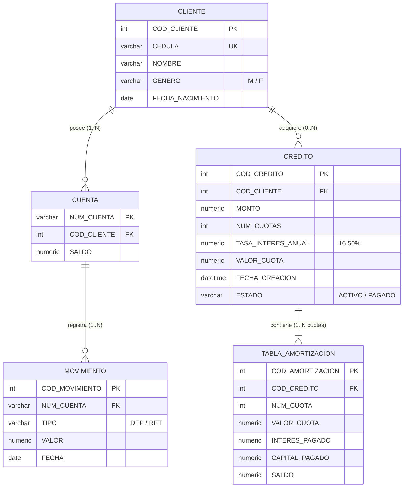

# Ítem 4: Diagrama Entidad - Relación del Sistema de la Comercializadora de Teléfonos (Puntaje: 1.0 / 1.0)

Según las especificaciones del examen práctico:
> *"El sistema de facturación de la comercializadora NO deberá contar con inventario, basta con solo tener una entidad donde se encuentren los electrodomésticos disponibles para la venta. Formas de pago: Efectivo (con 42% de descuento) y Crédito Directo (con BanQuito)."*

---

## Modelo Entidad - Relación del Sistema Core Bancario BanQuito (Módulo Crédito)

