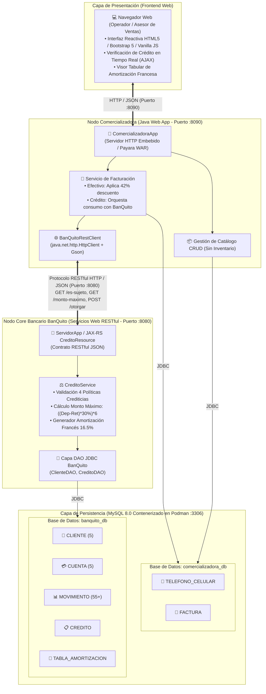

# Ítem 12: Diagrama de Arquitectura de la Solución Completa (Puntaje: 1.0 / 1.0)

La solución adopta un patrón arquitectónico distribuido orientado a servicios web RESTful, desacoplando completamente la aplicación comercializadora de venta de celulares del core bancario financiero BanQuito.

---

### Descripción Técnica de las Capas Arquitectónicas:

1. **Capa de Presentación (Frontend Web)**:
   - Implementada en HTML5 estándar con **Bootstrap 5.3** y **Bootstrap Icons**.
   - Consume endpoints asíncronos mediante la API nativa `fetch` de JavaScript.
   - Brinda una botonera interactiva para probar los **4 Clientes Oficiales del Tribunal** con un solo clic.

2. **Capa de Lógica de Negocio Comercializadora (Java Web Client :8090)**:
   - Administra el catálogo de teléfonos celulares (Ítem 8).
   - Liquida ventas en **Efectivo** otorgando el **42% de descuento**.
   - Consume en vivo el servicio web RESTful de BanQuito cuando la forma de pago es **Crédito Directo**.

3. **Capa de Servicios Web BanQuito Core (Java RESTful :8080)**:
   - Publica endpoints RESTful bajo el estándar **Jakarta RESTful Web Services (JAX-RS / Jersey)**.
   - Ejecuta las 4 reglas de negocio de evaluación crediticia.
   - Aplica la fórmula oficial de monto máximo: `((Promedio Depósitos - Promedio Retiros) * 30%) * 6`.
   - Genera y persiste la tabla de amortización con cuota fija mensual al **16.5% anual**.

4. **Capa de Persistencia (MySQL 8.0 en Podman :3306)**:
   - Dos esquemas independientes y normalizados: `comercializadora_db` y `banquito_db`.
   - Poblado con datos históricos consistentes que satisfacen los 5 clientes, 5 cuentas y más de 50 movimientos requeridos.
